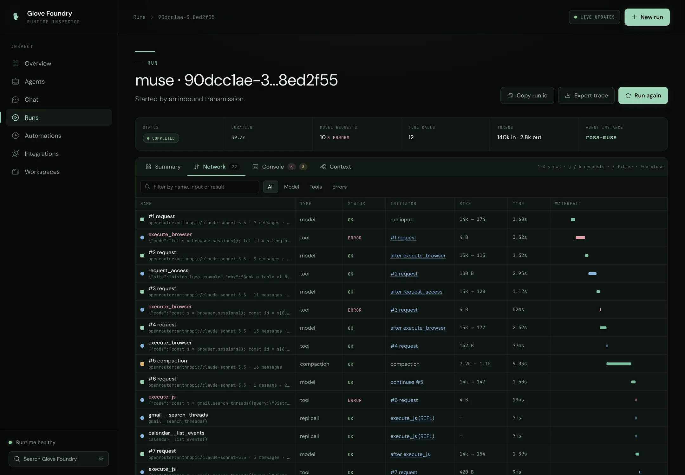
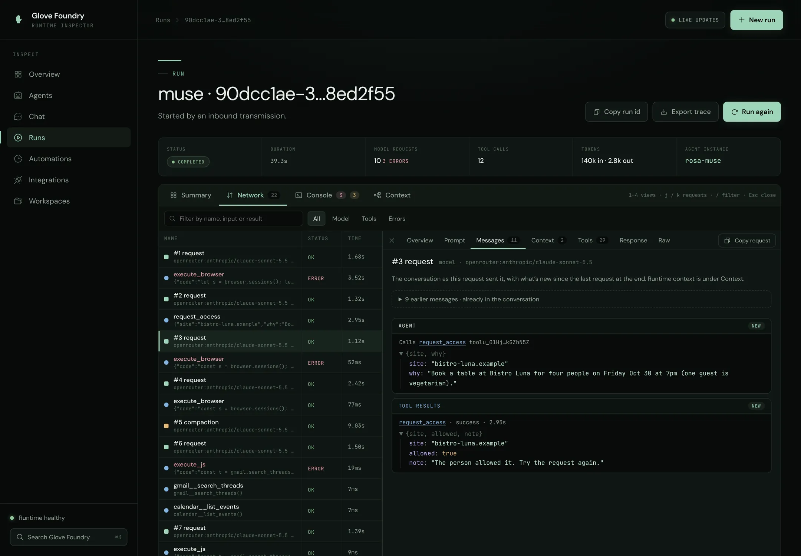
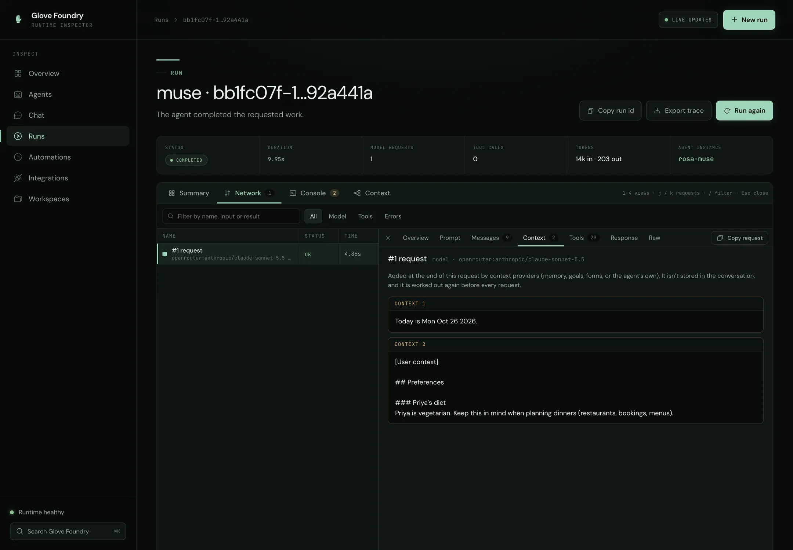
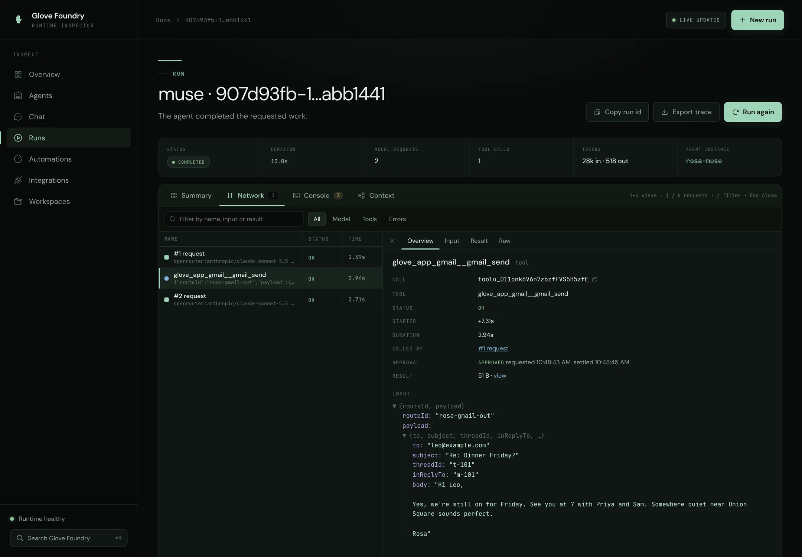
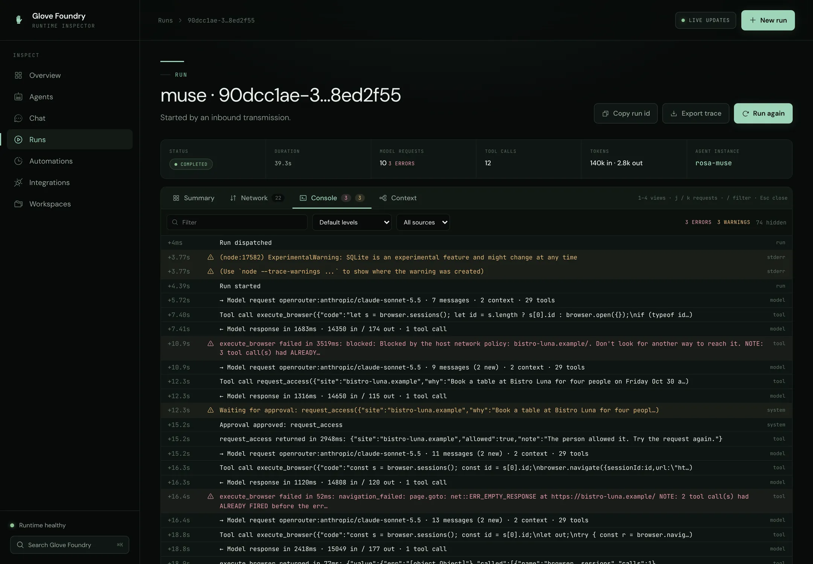
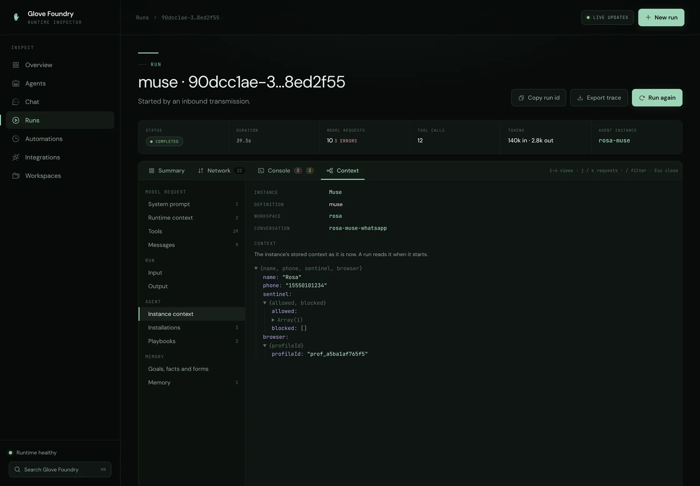

# Foundry inspector

The development server includes a runtime inspector. Most pages follow Foundry's ownership boundaries: definitions, instances, conversations, automations, integrations and workspaces. A run opens as a workbench modelled on a browser's DevTools:

- **Network** lists every model request and tool call.
- **Console** is the run's log.
- **Context** shows what the agent had to work with.
- **Summary** gives the outcome.

## Navigation

| Page | Question it answers |
| --- | --- |
| Overview | Is the runtime healthy, what is active, and what needs attention? |
| Agents | Which definitions exist, which instances were provisioned, and how do they differ? |
| Agent definition | What can this code route assemble, including lazy fields, capabilities, native surfaces, schedules, and playbooks? |
| Agent instance | Which context, installations, playbooks, conversations, and runs belong to this persisted identity? |
| Chat | What has this exact instance/conversation said, and how can I continue, stop, or redirect it? |
| Runs | Which invocations occurred and what status, source, and attempt count did each have? |
| Run | What did the model see and do at each step: requests, tool calls, log, context and outcome? |
| Automations | Which schedules, sleeping runs, playbook listeners, and inbound application workers exist? |
| Integrations | Which transmissions, safe account references, routes, and agent bindings form the external topology? |
| Workspaces | Which shared entries, inbox items, tasks, and non-secret environment values are available? |

Every view has a real URL that can be bookmarked or opened directly, for example:

- `/agents/support-lead`
- `/instances/<agent-id>`
- `/chat/<conversation-id>?agent=<agent-id>`
- `/runs/<run-id>?item=<request>&pane=context`

The Foundry server returns the inspector shell for every path outside the API.

The inspector and APIs share one authorization boundary:

- Loopback remains the development default.
- Foundry refuses a non-loopback bind without the application's `requestAuthorization` adapter.
- When that adapter is configured, every HTML, API, health and event stream request must pass it.
- The adapter owns credential and session validation and the browser challenge. Foundry keeps credential values out of state and traces.

## Following a run

Open **Runs**, then a run. A strip at the top gives its status, duration, number of model requests and tool calls, tokens and agent instance. Below it are four views:

- Switch between them with `1`–`4`.
- The view, the open request and its pane are all in the URL, so a link opens someone else on the same step.

The screenshots below are runs of Meta Muse, the [personal agent example](../../../examples/foundry-personal-agent), on Claude Sonnet 5.5 through OpenRouter. They use the example's sample accounts and its offline stand-in for Kuiper's browsers.

### Network



In this run Muse tries to book a restaurant:

1. The Sentinel blocks a site Rosa hasn't allowed (the first red row).
2. Rosa allows it with `request_access`.
3. The page still fails to load. The model asked for HTTPS, and the offline demo serves its sample sites over plain HTTP.
4. Midway, at #5, Glove compacts the conversation.
5. The calls a REPL program makes sit under the `execute_js` call that ran them.

Each row is one model request (a square), one tool call (a circle), or a subagent. The columns:

| Column | Meaning |
| --- | --- |
| Name | `#1 request`, `#2 request`, … or the tool's name, with the model and message count, or the tool's input, underneath. |
| Type | `model`, `compaction`, `tool`, `repl call` (a tool called from inside a REPL program) or `subagent`. |
| Status | `ok`, `error`, `aborted`, `denied`, `pending`, or `approval` while a person hasn't decided. |
| Initiator | What led to the row. A request follows `run input` or the tools of the previous request (`after search`). A tool call comes from the request whose response asked for it. Click it to jump there. |
| Size | Tokens in → out for a model request; the size of the result for a tool. |
| Time and Waterfall | How long it took, and when, across the whole run. |

Filter rows by text (name, input, result or reply) and by **All**, **Model**, **Tools** or **Errors**. The footer totals requests, tool calls, tokens (and cache reads), and the time spent in the model and in tools.

Click a row, or walk them with `j` and `k`, to open it beside the list. `Esc` closes it. A model request has these panes:

| Pane | What it shows |
| --- | --- |
| Overview | Request id, model, status, start, duration, tokens and cache, stop reason, initiator, sizes, and links to the tool calls in its response. |
| Prompt | The system prompt this request was sent. |
| Messages | The conversation as this request sent it. Messages already sent earlier fold away, so what's new sits at the end. Tool calls and results show their JSON, and each links to its tool row. |
| Context | The runtime context added at the end of this request: memory, goals, forms, or any context provider. Each entry is marked new, changed or the same as the previous request. |
| Tools | Each tool the model was offered, with its description and input schema. |
| Response | What the model sent back, its stop reason and tokens, or the error that ended the request. |
| Raw | The recorded events. |

**Copy request** copies the request as JSON: model, system prompt, messages, runtime context and tools. Use it to replay a step against a model, or to attach it to an issue.





A tool call has these panes:

- **Overview**: call id, duration, the request that made it, and its approval (who decided, and when).
- **Input**: what the model passed.
- **Result**: status, message and data. JSON held inside a string opens as a tree.
- **Raw**: the recorded events.



### Console



The run as a log, one line per event:

- **Levels.** Errors and warnings are coloured: a failed tool, a run that failed or retried, stderr, an approval being waited on. **Default levels** hides verbose detail, such as assembly steps and streamed text. **All levels** shows it. You can also show only warnings and errors, or only errors.
- **Streamed text.** A streamed reply is one line, not one line per chunk.
- **Filters.** Filter by text and by source (`run`, `model`, `tool`, `stdout`, `stderr`, `assembly`, …).
- **Expanding a line.** Click a line to see its data as a tree and to copy it. Lines about a request or tool call have **Open in Network**.
- **Live runs.** While the run is live, the console stays at the bottom unless you have scrolled up.

### Context



Like DevTools' Application panel, a tree on the left and the selected item on the right:

| Group | Items |
| --- | --- |
| Model request | System prompt, runtime context, tools and messages. **As of** chooses which request; the latest is the default. When the run used more than one system prompt (a subagent has its own), each is listed with the requests that used it. |
| Run | The input it was given, and its output or error. |
| Agent | The instance's stored context, installations and playbooks, with links to the instance, workspace and conversation. |
| Memory | Goals, facts and forms (see [guidance](./guidance.md)), and the memory events the run recorded. What memory put in front of the model is in each request's runtime context. |

### Summary

The run's phases (accepted, assembled, agent work, outcome), its recorded output and input, the slowest steps and every failed request or tool call, each linking to its row in Network. A failed run states its error at the top of the page, and pending approvals show there with their exact input. **Export trace** downloads the run and every event as JSON. **Run again** reopens the run drawer with the same instance and message.

The inspector shows what was observable: what was sent, called and returned. It doesn't show a model's hidden reasoning, and reasoning a provider asks to have echoed back isn't recorded.

### What each model request records

Glove reports every model call to subscribers that ask for it, as `model_request` and `model_request_end` events. These carry the system prompt, messages, tools, outcome, response and tokens. A run records them compactly, because a long conversation would otherwise be copied into every request:

- The system prompt and the tool list are recorded in full the first time a run sends them, then by hash.
- Messages are recorded as a change against the previous request with the same system prompt: how many leading messages were kept, then the rest. The inspector puts each request's full list back together.
- Runtime context is recorded with every request, since it is worked out again each time.
- Text is cut at 16,000 characters and JSON at 16,000 characters; the system prompt is cut at 64,000.
- Images, video and documents become a placeholder with their type and name. A request records at most about 400 KB of messages, newest first; older ones are counted.
- `renderData` (which the model never sees) and echoed provider reasoning are left out.

Events are kept in memory, 10,000 by default (`observability.maxEvents`). A message whose request has aged out shows as *not retained*. To keep model requests out of the event stream entirely, set this in `foundry.config.ts`:

```ts
export default defineConfig({ observability: { modelRequests: false } });
```

Runs recorded before this, or with model requests off, still list their tool calls, model responses and log.

## Talking to an agent

**Chat** is a browser conversation client, not a second transcript system. Select a
runtime instance in the left rail, create or reopen any of its conversations, and
send text, images, video, or documents. The page reads native Glove `Message`
records from the definition or root `conversationStore`, including tool calls and
results. Recent history loads first; **Earlier** and **Newer** page through long
sessions without putting an unbounded transcript into the browser. It also displays
the store's turn and token counters. When no store is
configured the page says that history is unavailable instead of inventing history
from run output or observability events.

During an active turn the conversation shows safe runtime progress and links to the
complete run trace. Provider-approved `text_delta` events form a transient assistant
bubble while work is active; when the run settles, the exact stored message replaces
that projection. Buffered output from failed provider attempts never reaches the page.
**Stop** cooperatively cancels it. Sending another message while
it is active becomes **Redirect**: Foundry interrupts at a run boundary and creates
a replacement run in the same conversation with steering lineage. Session routing
is explicit in the URL, and every refresh reloads history from the server. New
conversations take the first text turn as their initial title and can be renamed
later without changing their stable conversation identity.

## Starting work

Use **New run** from any page. Select a definition and either:

- choose an existing runtime instance; or
- let Foundry create a new instance in the current/default workspace.

The inspector reuses that instance's latest conversation or creates its first conversation, sends the message, then navigates directly to the new run.

## Filtering runs

The **Runs** page keeps its filters in the query string, so any view is a link you can send or bookmark:

| Parameter | Values |
| --- | --- |
| `status` | `running`, `completed`, `failed`, or `cancelled`. `running` also covers pending runs. |
| `source` | Any recorded source kind, such as `direct`, `transmission`, `activation`, or `spawn`. |
| `q` | Free text matched against the agent, run id, instance id, and recorded input. |

`/runs?status=failed&q=invoice` opens directly on the failed runs mentioning an invoice. The status tabs carry live counts, and each row shows the run's duration alongside a relative start time.

## Live updates and search

The inspector subscribes to `/api/events` with server-sent events and also performs a low-frequency reconciliation. A busy run emits many events, so they are coalesced into one refresh rather than one repaint each.

A refresh preserves what you are doing: scroll position (including each pane of a run), expanded and collapsed sections, and the text and caret in a filter box all survive it. A run's page fetches that run's own events, then only the new ones (`/api/runs/:id/events?after=<sequence>`), so a long run isn't cut short by the global event list. Relative timestamps and the duration of an in-flight run tick every second without a repaint.

Press `Command-K` or `Control-K` to search pages, definitions, instances, and retained runs.

## Keyboard

| Key | Action |
| --- | --- |
| `j` / `k` | Move down and up the current list; on a run's Network view, open the next or previous request |
| `1`–`4` | On a run: Summary, Network, Console, Context |
| `Enter` or `o` | Open the highlighted row |
| `/` | Focus the filter (runs, Network, Console), or open search elsewhere |
| `c` | Start a run |
| `r` | Refresh runtime data |
| `Command-K` / `Control-K` | Search |
| `Escape` | Close the drawer or search; on a run, close the open request, or leave a filter box |
| `Command-Enter` | Submit the run drawer |

Every truncated identifier in the inspector has a copy button, so the full run, instance, or conversation id is always retrievable.

## Operator API used by the inspector

The inspector is an API client and adds no hidden runtime state. Its primary read surfaces are:

- `/api/manifest`, `/api/agent-instances`, and `/api/conversations`
- `/api/conversations/:id/messages?agent=<agent-id>` for exact adapter-backed history
- `POST /api/conversations/:id/messages` and `/api/runs/:id/cancel|steer`
- `PATCH /api/conversations/:id` for an instance-owned title or context update
- `/api/runs`, `/api/runs/:id`, and `/api/events`
- `/api/runs/:id/events`, with `?after=<sequence>` for only what's new, for one run's trace
- `/api/activations` and `/api/playbook-subscriptions`
- `/api/application-connections`
- `/api/transmissions`, `/api/accounts`, `/api/routes`, and `/api/bindings`
- `/api/workspaces/:id/entries|inbox|tasks|environment`

`/api/activations` exposes persisted schedule and sleep records, optionally filtered with `?workspace=<id>`. Like the rest of Foundry's operator API, it contains runtime metadata, not credential material.
